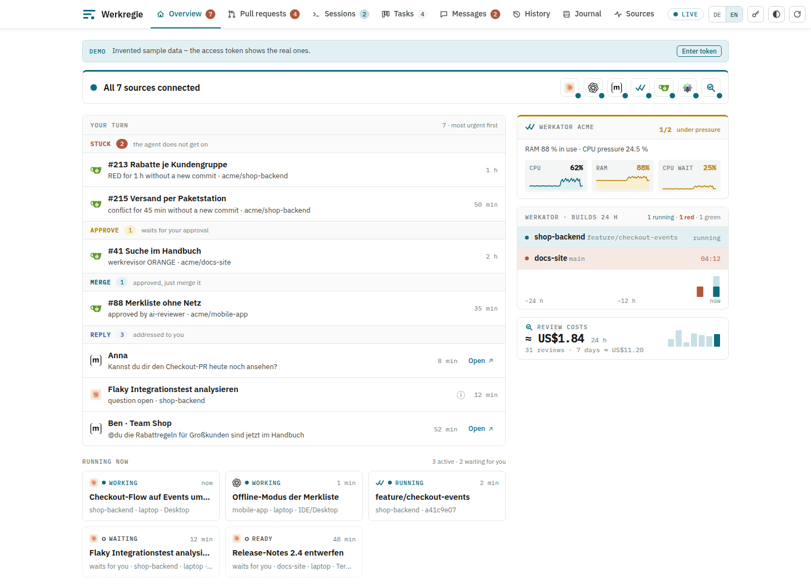
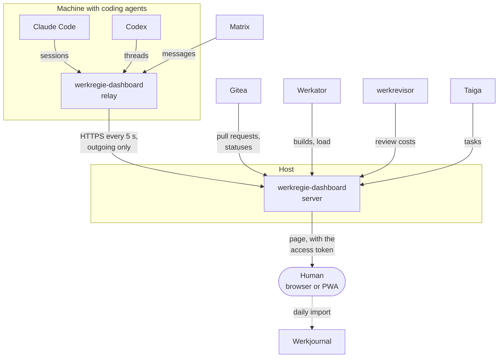

# Werkregie

Werkregie is to become the orchestrator for software development with AI agents:
it shall start the coding agents, steer them through plan, code, build and review,
and call the human only where a decision needs one.

**So far it is mainly a dashboard.**
The human still starts the agents and decides;
the dashboard shows what the agents, the build pipeline and the reviews are doing right now,
and where the human has to act.
A first piece of orchestration exists: `werkregie-dashboard watch-pr` tells a coding agent
when its pull request needs it.
The [plan](doc/werkregie.werkbaum) holds the orchestrator as the idea `#orchestrator`.

**Werkregie defines the workflow of the Werk family.**
[doc/agentic-workflow.md](doc/agentic-workflow.md) is the master copy of the agentic workflow
that all [Werk repositories](#the-werk-family) follow:
the roles of coding agent, review agent and human, the steps of a pull request, the review rounds,
the plan, the versions and the writing style.
A change goes into this copy first, then into each Werk repository with its next pull request.



The screenshot shows invented demo data;
[werkregie.javagil.de](https://werkregie.javagil.de) shows the same to any visitor without the access token.

## The Dashboard

- **Your turn:** pull requests and messages that wait for the human, grouped by what they ask:
  stuck, approve, merge, rework, reply.
- **Running now:** Claude Code sessions, Codex threads and Werkator builds, with the resume command of a session.
- **Pull requests** of every Gitea instance, with Werkator's build and werkrevisor's verdict.
- **Tasks** assigned to the user in Taiga, **messages** from Matrix, the **history** of 24 hours.
- **Journal:** a Werkjournal import of each day's work, proposed from what the sources recorded.
- Load of the Werkator hosts and the review costs of werkrevisor.
- Installable as an app (PWA); offline it shows the last state.

It only reads and links back to the tools; it changes nothing in them.
Details, modes and configuration: [dashboard/README.md](dashboard/README.md).

## Connections



The arrows show the flow of data; the dashboard only reads.
The relay runs where the agents run, because their state lies on that machine.
It opens outgoing connections only, also for the Matrix sync; nothing connects to the machine from outside.
The Matrix client runs in the relay, so that the device keys stay on the user's machine.

Without a host, the mode `local` reads everything on one machine and serves it on `127.0.0.1`.
[doc/system-architektur.md](doc/system-architektur.md) shows how all Werk tools work together, in German.

## The Werk Family

The Werk family is a set of tools for software development with AI agents, each in a repository of its own.
All of them follow the workflow that Werkregie defines.

| Tool                                                       | Role                                                               |
|------------------------------------------------------------|--------------------------------------------------------------------|
| [Werkbaum](https://werkbaum.javagil.de)                    | plans as a text notation; each repository keeps its plan in it     |
| [Werkator](https://git.javagil.de/mi/werkator)             | CI/CD for Gitea on a Hostsharing Managed Webspace                  |
| [Werkdock](https://git.javagil.de/mi/werkdock)             | container runtime without root, for Testcontainers in Werkator     |
| [werkrevisor](https://git.javagil.de/mi/werkrevisor)       | AI review of each pull request, run as a Werkator build            |
| [Werkcrappit](https://git.javagil.de/mi/werkcrappit)       | mutation CRAP metric as a Gradle and PIT plugin                    |
| [Werkjournal](https://git.javagil.de/mi/werkjournal)       | time records; takes the dashboard's daily import                   |
| Werkregie                                                  | dashboard and the workflow of the family; later the orchestrator   |

## Quick Start

Requires a JDK; Gradle fetches Temurin 25 through Foojay.

```sh
cd dashboard
./gradlew installDist
build/install/werkregie-dashboard/bin/werkregie-dashboard   # → http://localhost:4747/
```

Without a configuration it shows the Claude Code and Codex sessions of this machine;
[dashboard.example.yml](dashboard/dashboard.example.yml) adds Werkator, Gitea and the other sources.

## Documents

| File                                                       | Content                                                    |
|------------------------------------------------------------|------------------------------------------------------------|
| [doc/agentic-workflow.md](doc/agentic-workflow.md)         | the workflow of all Werk repositories, master copy         |
| [doc/werkregie.werkbaum](doc/werkregie.werkbaum)           | the plan: what runs, what comes next                       |
| [doc/system-architektur.md](doc/system-architektur.md)     | how the Werk tools work together                           |
| [doc/adrs/](doc/adrs/)                                     | decisions                                                  |
| [doc/prs/](doc/prs/)                                       | one document per pull request                              |
| [AGENTS.md](AGENTS.md)                                     | instructions for coding agents                             |

The working state is [Gitea](https://git.javagil.de/mi/werkregie);
[GitHub](https://github.com/mhoennig/werkregie) mirrors `main` only.
