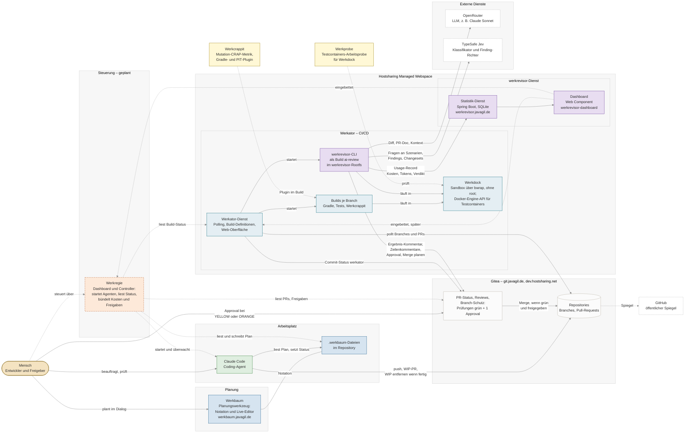

# System-Architektur

Wie die Werk-Bausteine zusammenarbeiten: von der Planung über Code, Build und Review bis zur Auswertung.
Werkregie ist noch nicht gebaut; heute übernimmt der Mensch ihre Rolle, daher sind ihre Kanten gestrichelt.

## Bausteine

| Baustein | Rolle |
|---|---|
| Werkbaum | Planung als Textnotation mit Und/Oder-Zerlegung; die `.werkbaum`-Dateien liegen im jeweiligen Repository. |
| Claude Code | Coding-Agent am Arbeitsplatz; legt Pull-Requests als WIP an und entfernt WIP, wenn implementiert, getestet und dokumentiert. |
| Gitea | Quelle der Wahrheit für Code, Pull-Requests, Status-Prüfungen und Branch-Schutz; GitHub ist nur Spiegel. |
| Werkator | Leichtgewichtiges CI/CD auf dem Managed Webspace; baut jeden Branch und Pull-Request und meldet den Status an Gitea. |
| Werkdock | Sandbox über `bwrap` ohne root, kompatibel zur Docker-Engine-API, soweit Testcontainers sie braucht. |
| werkrevisor | KI-Review als Werkator-Build: Regeln, LLM über OpenRouter und Jev über TypeSafe; gibt frei und plant den Merge. |
| werkrevisor-Dienst | Sammelt Kosten und Tokens aller Reviews und zeigt sie als einbettbares Dashboard. |
| Werkcrappit | Mutation-CRAP-Metrik als Gradle- und PIT-Plugin, im Build eines Projekts. |
| Werkprobe | Arbeitsprobe, die belegt, dass Testcontainers gegen Werkdock läuft. |
| Werkregie | Geplant: Dashboard und Controller, der Agenten startet, Status aus Werkator und Gitea liest und das werkrevisor-Dashboard einbettet. |
